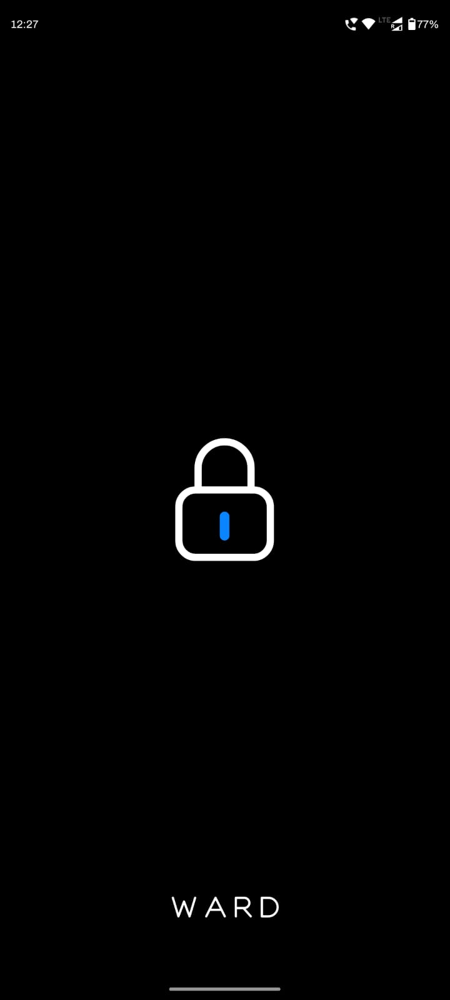
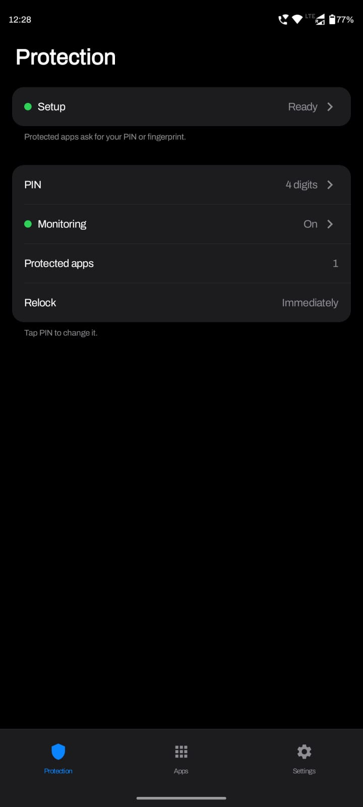
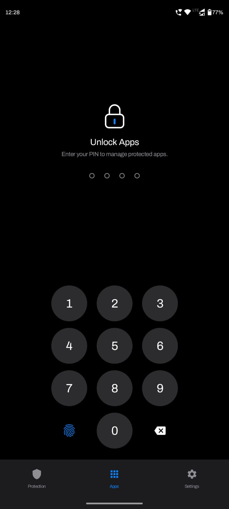
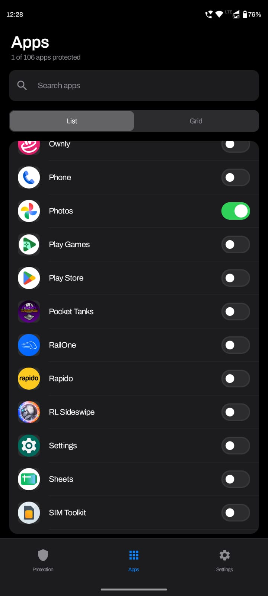
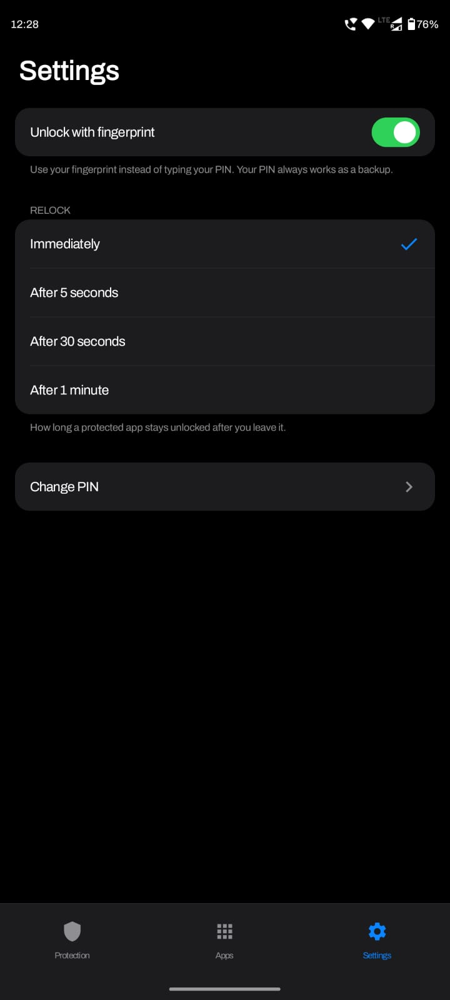

<div align="center">

# Ward — Android App Locker

### Your apps. Your privacy. Your control.

**A clean, ad-free Android app locker built with Kotlin and Jetpack Compose.**  
Protect selected apps with a PIN or biometrics, with a simple interface and no advertising clutter.

[**⬇ Download APK**](https://github.com/srijan-2/Ward--App-Locker/releases/latest/download/Ward.apk) · [View Releases](https://github.com/srijan-2/Ward--App-Locker/releases) · [Report a Bug](https://github.com/srijan-2/Ward--App-Locker/issues)

</div>

## Screenshots

<p align="center">
  
  
  
  
  
</p>

<p align="center">
  <em>Splash · Protection dashboard · PIN unlock · App selection · Settings</em>
</p>

---

> **APK download note:** The Download APK button works once a GitHub Release contains an APK asset named `Ward.apk`. See [Publishing an APK](#publish-an-apk-for-direct-download) below.

## Why Ward?

Your phone is personal. Access to your apps should feel personal, too.

Ward is designed to make app protection straightforward: choose the apps you want to lock, set up your authentication, and get on with your day. The interface is built with Jetpack Compose and Material 3, with no ad placements or advertising SDKs configured in the current project.

- **Ad-free experience** — no banner ads, interstitials, or ad placements in the current app.
- **Simple, focused interface** — Protection, Apps, and Settings sections without unnecessary clutter.
- **PIN protection** — set up a PIN and use it to unlock protected apps.
- **Biometric unlock** — use Android's biometric prompt when enabled and supported by your device.
- **Choose what to protect** — select installed apps instead of applying one blanket rule to everything.
- **Flexible relocking** — configure how quickly an app should lock again after you leave it.
- **Event-driven detection** — uses Android accessibility window-change events rather than continuously polling the foreground app.
- **Privacy-minded design** — the current manifest does not declare the `INTERNET` permission, and app preferences are stored locally with Android DataStore.
- **Screen-conscious lock screen** — the lock activity uses Android's secure-window flag to block screenshots of that activity and hide its preview in Recents.
- **No account required by the current implementation** — the app's core setup does not require signing in to an online account.

*Security note: these are project implementation details, not a guarantee that an Android app locker is impossible to bypass. Read [Security and limitations](#security-and-limitations) before relying on it for sensitive apps.*

## Download and install

### Option 1: Download the APK from GitHub

1. Tap **[⬇ Download Ward APK](https://github.com/srijan-2/Ward--App-Locker/releases/latest/download/Ward.apk)**.
2. On your Android device, open the downloaded `Ward.apk`.
3. If Android asks, allow your browser or file manager to install unknown apps for this installation.
4. Continue with the installation and open Ward.

If the download link says the asset is unavailable, visit the **[Releases page](https://github.com/srijan-2/Ward--App-Locker/releases)**. A release with the APK attached must be published before direct downloads will work.

**Compatibility:** the current Gradle configuration sets `minSdk = 31`, so the app targets Android 12 and newer. Device manufacturers and OS versions can affect accessibility-service behavior.

### Option 2: Install with ADB

With Android Debug Bridge installed and USB debugging enabled on your device:

```bash
adb install -r Ward.apk
```

### First-time setup

1. Open Ward and follow the setup flow to create a PIN.
2. Open the monitoring setup flow.
3. Enable Ward's Accessibility service in Android Settings and approve the system prompt.
4. Return to Ward and choose the apps you want to protect.
5. Optionally enable biometric unlock if your device supports it and you have enrolled a biometric.
6. Select your preferred relock delay.

The Accessibility service must be enabled manually by the user. Android does not let apps silently grant themselves this permission.

## Features

| Feature | Details |
| --- | --- |
| App selection | Browse installed apps and choose which ones to protect. |
| PIN authentication | Create and use a PIN for app unlock. |
| Biometric authentication | Android biometric prompt, when enabled and available. |
| Relock behavior | Configure the delay before a protected app requires authentication again. |
| Foreground detection | Accessibility window-state-change events; no continuous foreground polling. |
| Screen-state handling | Re-checks protection around screen-off and return-to-device events. |
| Settings persistence | Uses Android DataStore Preferences for app settings. |
| Lock-screen privacy | The lock activity uses `FLAG_SECURE` and is excluded from Recents. |
| UI | Kotlin, Jetpack Compose, and Material 3. |

## Tech stack

- **Language:** Kotlin
- **UI:** Jetpack Compose and Material 3
- **Navigation:** AndroidX Navigation Compose
- **Local settings:** AndroidX DataStore Preferences
- **Biometrics:** AndroidX Biometric
- **Concurrency:** Kotlin Coroutines and Flow
- **Build:** Gradle Kotlin DSL and version catalog
- **Testing:** JUnit and AndroidX instrumentation-test dependencies

## Build from source

### Requirements

- Android Studio with a compatible Android SDK and JDK.
- Android SDK 31 or newer for the current minimum SDK.
- A physical Android device or emulator for testing.

### Clone the repository

```bash
git clone https://github.com/srijan-2/Ward--App-Locker.git
cd Android-App-Locker
```

Open the project directory in Android Studio and allow Gradle sync to complete.

### Build a debug APK

Linux/macOS:

```bash
./gradlew assembleDebug
```

Windows:

```bat
gradlew.bat assembleDebug
```

The APK is normally generated at:

```text
app/build/outputs/apk/debug/app-debug.apk
```

### Run tests

Unit tests:

```bash
./gradlew test
```

Connected Android tests (requires a running emulator or connected device):

```bash
./gradlew connectedAndroidTest
```

## Publish an APK for direct download

The README's **Download APK** button points to the latest GitHub Release asset named `Ward.apk`. To make it work:

1. Build the APK and test it on a real device.
2. In GitHub, open the repository's **Releases** section and create a new release.
3. Choose a version tag, for example `v1.0.0`.
4. Attach the APK file and name the uploaded asset exactly **`Ward.apk`**.
5. Publish the release.

The direct-download URL will then be:

```text
https://github.com/srijan-2/Ward--App-Locker/releases/latest/download/Ward.apk
```

For a release build, use Android Studio's **Build → Generate Signed Bundle / APK** flow and sign the APK with your release key. Keep the keystore and passwords private and backed up securely. Updates should use the same signing key. Do not distribute an unsigned or untested build as a production release.

## Project structure

Main source package: `com.antimatter.applocker`.

```text
app/src/main/
├── AndroidManifest.xml
├── java/com/antimatter/applocker/
│   ├── AppLockerApp.kt
│   ├── MainActivity.kt
│   ├── data/             # Installed apps, protected apps, PIN and settings storage
│   ├── lock/             # Lock engine and protected-app lock activity
│   ├── security/         # Authentication session and security-related code
│   ├── service/          # Accessibility service and monitoring runtime
│   └── ui/
│       ├── apps/         # Installed-app selection UI
│       ├── dashboard/    # Protection dashboard
│       ├── monitoring/   # Monitoring setup flow
│       ├── navigation/   # Compose navigation graph
│       ├── pin/          # PIN setup/change flows
│       ├── settings/     # User settings
│       ├── setup/        # Initial setup
│       ├── theme/        # Compose theme
│       └── unlock/       # PIN/biometric unlock UI
└── res/
    ├── values/
    └── xml/              # Accessibility service configuration and backup rules
```

## How app locking works

1. Android sends window-state-change events to Ward's enabled Accessibility service.
2. The service filters out its own lock screen and certain framework, dialog, and keyboard windows.
3. The lock engine checks whether the foreground package is in the protected-app list.
4. If authentication is required, Ward opens its lock activity.
5. After successful authentication, the app remains unlocked according to the configured relock delay.
6. Screen-off is treated as leaving the app, and protection is checked again when the user returns.

This approach is event-driven rather than based on continuous polling.

## Security and limitations

Ward is a personal app-locking layer, not a replacement for Android's device lock or an operating-system security boundary.

- **Accessibility permission:** Ward needs this permission to detect app transitions. Review the permission prompt and only enable the service if you trust the build.
- **No absolute bypass protection:** a person with sufficient access to the device may disable the Accessibility service, force-stop or uninstall Ward, or use device-specific workarounds.
- **Device differences:** Android versions and manufacturers can affect service lifecycle, app switching, and background behavior. Test on the devices you plan to use.
- **Screenshot protection scope:** `FLAG_SECURE` applies to Ward's lock activity; it does not block screenshots inside the third-party app being protected.
- **Local-only is not a blanket security guarantee:** the current manifest does not declare `INTERNET`, but users should still review the code, dependencies, build provenance, and Android backup settings before trusting any APK with sensitive use.
- **APK authenticity:** download releases only from this repository, and verify release details before installing. Anyone can build from source, but a locally built APK may have a different signing certificate from the published APK.

## Contributing

Issues and pull requests are welcome. When reporting a bug, include your Android version, device model, steps to reproduce, and relevant logs. Do not include PINs or other private data in bug reports.

## License

No license is currently specified in this README. Unless a license is added to the repository, assume that the source is not granted an open-source license by default.
